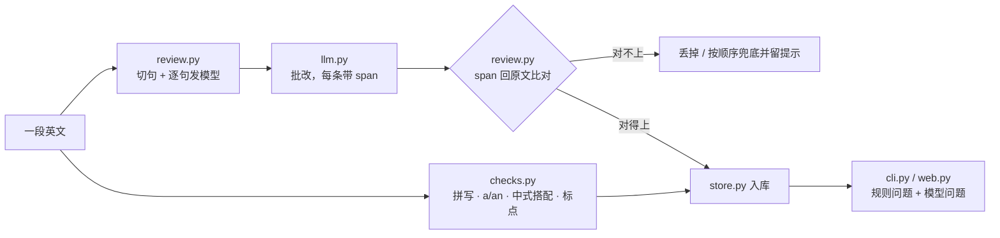

# Yuban · English Writing Coach

[](https://github.com/wushiyi105-jpg/yuban/actions) []() [](./LICENSE) [](https://codecov.io/gh/wushiyi105-jpg/yuban)

An English writing coach. Paste a paragraph in and it does two things: rules pick out the hard errors that can be computed, the model picks out the problems you only see once you have understood the text.

Two rules run through everything: **every correction has to point at a fragment of the original** — if it cannot, it is dropped; **whatever can be computed locally never goes to the model**, so the model neither misses things nor invents them.


## Why two layers, no way around it

I first let the model take the whole job. It judged `a apple` as an "article error" but said the span was `apple` (there is no standalone "apple" in the original), and it also flagged a perfectly correct `The museum is very big` as "not idiomatic enough", on the grounds that "big could give way to spacious".

That is not the model being dumb — this task genuinely has two kinds of answer: `a` should be `an` is a lookup, no sense of language required; whether "big" should become "spacious" is sense, and it varies by person.

So I split it:

| Who | Handles | Why |
| --- | --- | --- |
| Rules | Spelling, a/an, Chinglish collocations, repeated words, punctuation | One right answer, and getting it wrong once is embarrassing enough |
| Model | Tense, singular/plural, word order, idiomatic phrasing, whole-paragraph rewrite | Only visible once you have read the context |

The rule layer is a word list plus regex: it cannot see anything outside the list, but it does not invent. The model layer can invent, so every item goes through verification.

## One real run

The sample is `samples/第一篇.txt`, a deliberately broken piece of Chinese-student English:

```
Last weekend I very like go to the museum with my friend. We take many photo and eat a apple in the garden. The museum is very big and very beautiful. I think it is a good place for study history. How to say, I want to go there again next time, and I will recieve the ticket by email.
```

Rules first, four items:

```
[中式表达] very like —— like 本身就是动词，不加 very，用 really like
[中式表达] How to say —— 用 how do you say / how should I put it
[拼写] recieve —— 应为 receive
[冠词] a apple —— apple 以元音音素开头，用 an
```

Then the model, eight items, sentence by sentence:

```
· Last weekend I very like go to the museum with my friend
    [时态] very like → really liked     Last weekend 要求过去时
    [搭配] go to → going to             like 后接动名词
    改：Last weekend I really liked going to the museum with my friend.

· We take many photo and eat a apple in the garden
    [时态] take → took
    [单复数] photo → photos             many 后接可数名词复数
    [时态] eat → ate                    与 take 并列，时态一致
    改：We took many photos and ate an apple in the garden.

· I think it is a good place for study history
    [搭配] for study → to study         表目的用不定式
    改：I think it is a good place to study history.

· How to say, I want to go there again next time, and I will recieve the ticket by email
    [用词] How to say → How should I put it
    [拼写] recieve → receive
```

Not one of the eight is wrong. It even noticed that `take` and `eat` have to change together — fixing one alone leaves the sentence broken.

## Verification: three real traps

**One: the model tidies punctuation when copying.** After the first run, all five sentences were reported as "not in the original", more warnings than problems. The cause: when copying `original` the model dropped the final period, and my comparison only stripped whitespace. Stripping punctuation too fixed it — `Last weekend I like it` and `Last weekend I like it.` are the same sentence.

**Two: a span can swallow a whole phrase.** Once the model gave `span` as `very like go to`, a fragment spanning several words, calling it "one collocation error". That genuinely exists in the original, so verification let it through — but it is really a rewrite rather than a pointed problem. I filed that under type classification, not verification, because blocking it would mean guessing what the model meant, which is another kind of invention.

**Three: the model's sentence count does not match the original's.** It merges two sentences into one (`How to say, I want to...` was one sentence split in two anyway), or only corrects three of five. So I do not locate by "sentence n"; I have it copy the original sentence, fall back to order when that fails, and leave a `!` note in the result. A note is better than a misplacement — misplacement means "改：We took many photos" hangs under `The museum is very big`, which is worse than no correction at all.

## Accumulation: what one piece cannot tell you

One piece with "7 errors" says nothing. What is actually useful is "you have been flagged for tense 11 times in three months".

So every issue goes into its own table (`issues`), with type, source fragment and origin (rule/model). `stats` aggregates by type, and `write` reports the running total after each run — only when the same type shows up in three consecutive pieces does that hint fire.

That is the only reason this project has `sqlite` at all: not to store essays, but to count by type.

## Data flow

How one piece of data moves between the modules:



## Quick start

```bash
git clone https://github.com/wushiyi105-jpg/yuban.git && cd yuban
cp .env.example .env      # fill in LLM_API_KEY

python -m yuban check samples/第一篇.txt     # rules only, costs nothing
python -m yuban write samples/第一篇.txt --level B1
```

Start the Web UI:

```bash
python -m yuban serve      # http://127.0.0.1:8775
```

## Commands

| Command | What it does |
| --- | --- |
| `check <文件或文字>` | Local rules only |
| `write <文件> [--title] [--level] [--no-model]` | Rules + model, stored |
| `list` / `show <id>` / `rm <id>` | Record management |
| `stats` | Recurring-error stats |
| `serve [--port]` | Web UI |

## The Web UI

Paste English on the left; `只跑规则` returns instantly (no cost, no wait), `让模型看一遍` actually sends the request. The right side lists sentence by sentence, with issues under each, and a whole-paragraph rewrite at the end.

If the model dies you get a 502, and the rule results on the left are still there — the page does not go blank because one request failed.

## Design trade-offs

- **Zero third-party dependencies**, Python 3.10+, standard library.
- **Word lists stay short.** The spelling list holds only 20 genuinely common ones. One false positive and people stop trusting the check; a miss costs far less.
- **No "is this sentence good" judgement.** Style is a personal choice; the model may offer a rewrite, but should not score the original's style.
- **Rewrites are not written back into the original.** The rewrite lives in its own column; the original always stays as written — practice is about revising, not overwriting.
- **The same piece can be submitted repeatedly.** No de-duplication: rewriting the same paragraph three days later is practice, not duplication.

## Limits

- The Chinglish list has only 22 entries; semantic problems (say, "this sentence is actually answering the previous one") are left to the model.
- No speaking, no pronunciation.
- Long texts get truncated; the model cannot see the whole piece in one call — split anything beyond a few hundred words.

## Tests

```bash
python -m unittest discover -s tests
```

97 cases, all offline. The model is always a double; the Web layer starts a real server on `port=0`.

Covered: sentence length and repetition stats, a/an vowel detection with six exception classes, spelling list hits, Chinglish hits preserving original case, cross-word fragments let through, spans not found being dropped, order fallback when sentence counts mismatch, type whitelist merging, JSON with fences and with preamble, SQLite cascade delete and bad-JSON fallback, every CLI subcommand, and the three Web failure paths 404/400/502.

## Configuration

`.env` (in `.gitignore`):

```
LLM_API_KEY=...
LLM_BASE_URL=https://open.bigmodel.cn/api/paas/v4
LLM_MODEL=glm-4.6
```

Works with any OpenAI-style `/chat/completions`. `--api-key --base-url --model` override it.

---

Author: shiyi
Email: wushiyi105@gmail.com
GitHub: [wushiyi105-jpg](https://github.com/wushiyi105-jpg)
